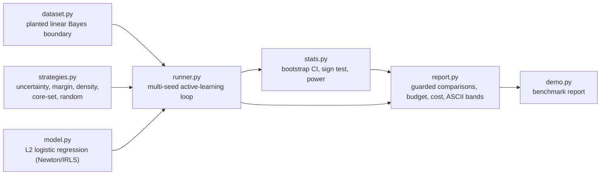

# labelbudget

An active-learning benchmark that reports labels-to-target-accuracy with variance across seeds, next to the random baseline.

[](https://github.com/Vengaiahmadineni/labelbudget/actions/workflows/ci.yml)

## Why

Expert labelling is expensive: a clinician reviewing clinical notes can cost $90 an hour. Teams often label thousands of examples because that felt safe, without measuring how few well-chosen ones would have reached the same accuracy. Active-learning papers make this worse by showing a single accuracy-versus-labels curve, and single runs are notoriously seed-sensitive: one seed can show a 2x advantage that vanishes on replication. labelbudget runs every strategy over many seeds, keeps the random-sampling baseline front and centre, and refuses to declare a winner when the evidence does not support one.

## Features

- Pluggable acquisition strategies: uncertainty, margin, information density, core-set, and random, plus a deliberately bad "most confident" strategy used to test the guard.
- Multi-seed runner with a fixed labelling budget; the random baseline is always run and reported.
- Headline metric is labels to reach a target accuracy (97% of the full-pool score), with median, quartiles and censoring counts per strategy.
- Comparison guard: paired bootstrap confidence interval plus exact sign test, and no comparative claim below 10 seeds. Overlapping evidence is reported as "indistinguishable at N seeds".
- Power analysis: how many seeds are needed to resolve a given label difference.
- Cold-start analysis and an ASCII median/IQR band chart of accuracy versus labels.
- Cost report converting label counts into money at a configurable hourly rate and minutes per label, using the budget that reached target on 90% of seeds.
- Pure Python standard library: no dependencies to install.

## Architecture



`dataset.py` generates a synthetic pool with a known Bayes-optimal boundary, so the ceiling is known exactly. `runner.py` runs the active-learning loop for each strategy and seed, using the hand-written logistic regression in `model.py`, and records labels-to-target and accuracy curves. `stats.py` supplies the paired statistics and `report.py` turns them into guarded claims, budgets and costs.

## Quick start

Requires Python 3.11+ and nothing else.

```bash
git clone https://github.com/Vengaiahmadineni/labelbudget.git
cd labelbudget
python -m unittest discover -s tests -v   # 25 tests
python -m src.demo                        # 30-seed benchmark, guard and budget report
```

## Usage

`python -m src.demo` prints six sections. Trimmed output (30 seeds, pool 300, seed set of 4 random labels, batch 8, budget 164):

```text
[1] What ONE seed would have told you
  seed  0: uncertainty  20 labels vs random  84 labels -> 'uncertainty is 4.2x better'
  seed  6: uncertainty 156 labels vs random  76 labels -> 'random is 2.1x better'
  over 30 seeds: uncertainty 'wins' 14, random 'wins' 13, ties 3

[2] Labels to target per strategy (censored = never reached target in budget)
  strategy      median      Q1      Q3     sd  censored
  random          76.0    44.0    84.0   38.3      2/30
  uncertainty     52.0    36.0    92.0   46.1      1/30
  coreset         48.0    28.0    68.0   46.2      3/30

[3] Comparative claims (paired bootstrap CI + exact sign test, alpha 0.05)
  uncertainty vs random: indistinguishable at 30 seeds (mean diff -5.9 labels, 95% CI [-24.3, +12.8], sign p=1.000)
  coreset vs random: indistinguishable at 30 seeds (mean diff -14.7 labels, 95% CI [-28.5, +1.3], sign p=0.108)

[6] Label budget that reached target on 90% of seeds, at $90/hour, 6 min/label
  random        118 labels = $   1062  (censored 2)
  uncertainty   134 labels = $   1206  (censored 1)
  coreset       115 labels = $   1035  (censored 3)
```

## How it works

- **One seed lies.** Seed 0 shows uncertainty sampling 4.2x better than random; seed 6 shows random 2.1x better. Across 30 seeds uncertainty "wins" 14, random 13, with 3 ties.
- **Thirty seeds: indistinguishable.** The medians look like a 30% saving, but the paired test cannot resolve it. The guard prints "indistinguishable at 30 seeds" and refuses any claim at 5 seeds.
- **Power.** The paired-difference sd is 52.9 labels (uncertainty) and 41.9 (core-set). Thirty seeds can only detect differences of about 27 and 21 labels, and a 10-label effect would need 220 and 138 seeds.
- **Budget.** The recommended budget is the number of labels that reached target on 90% of seeds. A strategy that misses target on more than 10% of seeds gets "buy more than the budget" instead of a number.
- **The guard detects real effects.** A deliberately bad strategy (label the most confident points) is flagged worse than random at 10 seeds in the test suite, while margin and uncertainty, which are provably identical for binary problems, produce zero paired difference. On planted-null simulations (200 trials, 30 seeds each) the guard's false-positive rate stays under 5% plus 3 standard errors, while a single-seed comparison names a "winner" more than 80% of the time.
- **Censoring.** Runs that never reach target are censored at budget plus batch, a lower bound; censor counts are printed beside every median.

Mean full-pool balanced accuracy is 0.832 against a planted Bayes ceiling of 0.841.

See [docs/ARCHITECTURE.md](docs/ARCHITECTURE.md) for the design decisions and failure modes.

## Testing

```bash
python -m unittest discover -s tests -v
```

The suite checks reproducibility for a given seed, that the random baseline is always run and reported, that the guard refuses claims below the minimum seed count, that a deliberately bad strategy is detected as worse than random, that margin and uncertainty give identical results in the binary case, and the guard's false-positive rate on planted-null simulations.

## Project layout

```text
src/
  dataset.py      synthetic data with a planted Bayes boundary
  model.py        L2 logistic regression (Newton/IRLS)
  strategies.py   acquisition strategies
  runner.py       multi-seed active-learning loop
  stats.py        bootstrap, sign test, power
  report.py       guarded comparisons, budget, cost, ASCII bands
  demo.py         benchmark entry point
tests/            unittest suite
docs/             architecture notes
```

## Limitations

- Data is synthetic Gaussian with a linear boundary, not real clinical text. The regime where active learning helps (for example heavy imbalance, `regime="imbalanced"` in `src/dataset.py`) is generated but not part of the timed demo.
- Scale is small (pool 300, 12 features) so that 30 seeds finish in seconds of pure Python; effect sizes will differ on real embeddings.
- BALD is not implemented, since it needs a Bayesian or ensemble model.
- Density and margin strategies are implemented and tested but left out of the demo; margin is identical to uncertainty in the binary case.
- The 6 minutes per label cost is an assumed parameter, not a measurement.
- It is not an annotation tool; it tells you how much annotation to buy.

## License

MIT, see [LICENSE](LICENSE).

## Maintainer

Maintained by **Vengaiah Madineni**, Data Scientist focused on machine learning and statistical solutions, including predictive analytics, model validation, and customer and risk analytics.

- GitHub: [Vengaiahmadineni](https://github.com/Vengaiahmadineni)
- Email: [vengaiahchowdarymadineni@gmail.com](mailto:vengaiahchowdarymadineni@gmail.com)