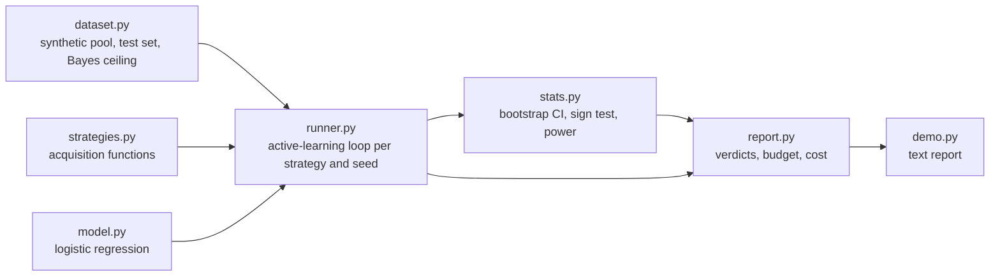

# Architecture

## Context

Labelling budgets for supervised models are usually guessed. labelbudget measures how many labels each acquisition strategy needs to reach a target accuracy, across many seeds, so that a budget can be set from evidence and a spurious "winner" is not reported.

## Container view

Everything is in-process and uses the standard library only. Each run is determined by its seed, so results are reproducible and paired across strategies.

## Key decisions

- **Labels-to-target, not accuracy curves.** The metric is the number of labels needed to reach 97% of the full-pool score. It maps directly to a budget. Runs that never reach target are censored at budget plus batch and the censor count is always printed.
- **Paired comparison over many seeds.** Each seed gives every strategy the same data, so differences are paired. The guard uses a bootstrap confidence interval and an exact sign test, and emits no claim below 10 seeds. The trade-off is that small effects need many seeds; the power section reports how many.
- **Random baseline always present.** Every comparison is against random, which active learning often beats only slightly.
- **Planted boundary.** Synthetic data with a known Bayes ceiling lets the tests check the guard against known truth, including planted-null simulations and a deliberately bad strategy.
- **Dependency-free model.** A hand-written L2 logistic regression solved with Newton/IRLS keeps the project runnable anywhere, at the cost of speed and model variety (no BALD).

## Failure modes

- Fewer than 10 seeds: no comparative claim is emitted.
- Overlapping confidence evidence: the report says "indistinguishable at N seeds" rather than naming a winner.
- A strategy missing target on more than 10% of seeds: the budget report says to buy more than the budget instead of giving a number.

## Out of scope

Annotation tooling, real text datasets and embeddings, and Bayesian acquisition functions.
